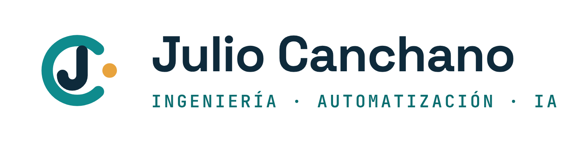

# Estudio de mercado y propuesta de negocio
## Servicio: configuración integral de perfil laboral + automatización de búsqueda de empleo (Colombia)

*Fecha del estudio: 17 de noviembre de 2026 · TRM de referencia: ~$3.300 COP/USD*

---

## 1. Qué se vende

Un servicio "llave en mano" para que una persona quede lista para buscar empleo de forma profesional y semiautomatizada:

1. **Hoja de vida optimizada para ATS** (filtros automáticos de los reclutadores).
2. **LinkedIn reconfigurado**: titular, "Acerca de", experiencias reescritas con logros, aptitudes, licencias y certificaciones, URL personalizada, banner, "Open to Work" y alertas.
3. **Reorganización de certificados**: inventario, orden por relevancia, carpeta digital (Drive/Notion) con enlaces verificables y carga en LinkedIn.
4. **Portales de empleo**: elempleo, Computrabajo, Magneto, Indeed y el Servicio Público de Empleo, con perfiles coherentes entre sí.
5. **Automatización de la búsqueda**: alertas por cargo/ciudad/salario en cada portal → llegan a un correo dedicado → Claude las lee, filtra y **clasifica** (encaje alto/medio/bajo, salario, modalidad) en una hoja de cálculo o tablero.

El diferencial frente a la competencia es el punto 5: casi todos venden "hoja de vida + LinkedIn" como un entregable estático. Tú vendes un **sistema que sigue trabajando** después de la entrega.

---

## 2. Precios del mercado

### 2.1 Competencia directa en Colombia

| Proveedor / referencia | Qué incluye | Precio |
|---|---|---|
| [Mi Hoja de Vida](https://www.mihojadevida.com.co/servicios) | Hoja de vida ATS + LinkedIn (planes) | **$239.000 – $289.000 COP** (plan alto ≈ USD 70 en el exterior) |
| [Hojas de Vida Colombia](https://co.linkedin.com/company/hojas-de-vida-de-colombia) | HV + perfiles en elempleo, LinkedIn, Computrabajo + preparación de entrevista | No publica precio (cotización) |
| [elempleo – membresías](https://www.elempleo.com/co/) | Asesoría grupal de HV, visibilidad | $35.000 – $107.900 COP |
| Coach de carrera presencial en Bogotá ([Doctoralia](https://www.doctoralia.co/tratamientos-servicios/coaching-personal/bogota)) | Sesión de mentoría de carrera | ~$280.000 COP por sesión |
| Coaching general ([Superprof](https://www.superprof.co/clases/coaching/colombia/)) | Sesión por hora | $20.000 – $42.000 COP/h (promedio) |
| Gratis: [Agencia de Empleo Colsubsidio](https://www.colsubsidio.com/blog-y-noticias/encuentra-empleo-mejora-perfil), cajas de compensación, SPE | Talleres y asesoría básica | $0 |

### 2.2 Referencia internacional (freelancers, Fiverr)

| Nivel | USD | Equivalente COP (TRM 3.300) |
|---|---|---|
| Entrada | hasta $50 | hasta ~$165.000 |
| Medio | $50 – $200 | $165.000 – $660.000 |
| Alto (reescritura completa + informe) | $200 – $400 | $660.000 – $1.320.000 |
| Agencia en España ([B2B con LinkedIn](https://b2bconlinkedin.com/optimizacion-perfil-linkedin/)) | €200 + IVA solo LinkedIn | ~$780.000 |

### 2.3 Otros datos de contexto

- **LinkedIn Premium Career**: USD 39,99/mes ≈ **$132.000 COP/mes**. Sirve de ancla: el cliente ya entiende pagar eso por *una* herramienta.
- **Salario mínimo 2026**: $1.750.905 (alza del 23 %). **Desempleo**: 10,9 % en enero de 2026 (DANE), y la proporción de empleos nuevos que pagan más de un mínimo cayó a ~10 % (Anif). Hay mucha gente buscando y es difícil diferenciarse, así que la demanda existe.
- **Outplacement** (LHH, ManpowerGroup/Right Management): lo pagan las empresas, no publican tarifas y es un canal B2B posible a mediano plazo.

### 2.4 Promedio del sector

| Tipo de servicio | Rango típico en Colombia | Promedio |
|---|---|---|
| Solo hoja de vida | $80.000 – $180.000 | **~$130.000** |
| Hoja de vida + LinkedIn | $200.000 – $300.000 | **~$260.000** |
| HV + LinkedIn + portales + entrevista | $350.000 – $600.000 *(estimado; nadie lo publica)* | **~$450.000** |
| Acompañamiento de búsqueda / coaching continuo | $250.000 – $300.000 por sesión o mes | **~$280.000** |

> **Advertencia:** los precios públicos en Colombia son escasos. Los rangos de las dos últimas filas son estimaciones a partir de los pocos datos publicados y de la referencia internacional. Antes de lanzar, confírmalos con 3 o 4 cotizaciones de cliente incógnito, por ejemplo a Hojas de Vida Colombia y a coaches en LinkedIn o Instagram.

---

## 3. Cuánto puedes cobrar: propuesta de paquetes

Posicionamiento: **por encima del "HV + LinkedIn" básico, por debajo del coaching ejecutivo**, justificado por la automatización.

| Paquete | Incluye | Precio sugerido | Tiempo estimado con Claude |
|---|---|---|---|
| **Esencial** | HV ATS (1 versión) + LinkedIn optimizado + certificados organizados y cargados | **$249.000** | 2 – 2,5 h |
| **Profesional** ⭐ (el que más debes vender) | Todo lo de Esencial + 4 portales configurados + alertas + **tablero automático de vacantes clasificadas** + videollamada de entrega (45 min) | **$549.000** | 4 – 5 h |
| **Búsqueda Acompañada 60 días** | Todo lo de Profesional + HV en inglés + 2 simulacros de entrevista + **informe semanal de las mejores vacantes** (curado con Claude) + ajustes del perfil | **$990.000** (o 2 cuotas de $520.000) | 8 – 10 h repartidas |
| **Mantenimiento** (después de cualquier paquete) | Informe semanal de vacantes + 1 ajuste mensual | **$120.000/mes** | ~1 h/mes |
| **Corporativo / universidades** | Paquete Profesional para grupos (egresados, outplacement), desde 10 personas | **$350.000 – $420.000 por persona** | economía de escala |

**Precio de lanzamiento** (primeros 10 clientes, a cambio de testimonio y antes/después): Profesional a **$399.000**.

### Por qué estos precios se sostienen
- El Esencial queda en línea con el líder local (~$260.000), así que no compites por precio.
- El Profesional cuesta ~2× el básico del mercado, pero entrega 4 portales y un sistema automatizado que nadie ofrece. En Fiverr equivale a ~USD 165, el rango medio internacional.
- Equivale a **~31 % de un salario mínimo** o a **~4 meses de LinkedIn Premium**, fácil de justificar si el cliente aspira a un cargo profesional.
- Ingreso efectivo por hora en el Profesional: $549.000 / 5 h ≈ **$110.000/h**, competitivo frente al coaching.

---

## 4. Cómo lo ejecutas con Claude (flujo operativo)

| Paso | Qué haces tú | Qué hace Claude |
|---|---|---|
| 1. Diagnóstico | Formulario de ingreso (Google Forms) + HV actual + PDF de LinkedIn + certificados | Lee todo, detecta vacíos e inconsistencias y propone 2 o 3 cargos objetivo |
| 2. Hoja de vida | Validas logros con el cliente | Reescribe con palabras clave del cargo y formato ATS (docx/PDF) |
| 3. LinkedIn | Cargas los textos en la cuenta del cliente **o se los entregas listos para pegar** | Redacta titular, "Acerca de", experiencias con logros cuantificados y aptitudes |
| 4. Certificados | Recibes los archivos | Inventaría, renombra, ordena por relevancia y genera la tabla para LinkedIn y Drive |
| 5. Portales | Creas o actualizas perfiles y alertas | Adapta los textos a los límites de cada portal |
| 6. Automatización | Correo dedicado del cliente + Google Sheets | Cada día o semana lee las alertas, extrae cargo, empresa, salario y modalidad, puntúa el encaje y escribe en el tablero |
| 7. Entrega | Videollamada y manual de uso | Genera el manual y el informe inicial de vacantes |

**Costos de operación aproximados (mensuales):**
- Plan de Claude: ~USD 20 – 100/mes → $66.000 – $330.000
- Google Workspace o correo: $0 – $30.000
- Canva Pro (banners, opcional): ~$40.000
- **Total: ~$100.000 – $400.000/mes.** Con 1 o 2 clientes Profesional al mes ya cubres los costos fijos.

---

## 5. Proyección simple de ingresos

| Escenario | Clientes/mes (mezcla) | Ingreso mensual estimado |
|---|---|---|
| Arranque | 3 Esencial + 3 Profesional | ~$2.400.000 |
| Medio | 4 Esencial + 6 Profesional + 2 Acompañada + 5 mantenimientos | ~$7.900.000 |
| Con un convenio B2B | lo anterior + 1 grupo de 10 personas a $380.000 | ~$11.700.000 |

---

## 6. Riesgos y reglas que debes cumplir

1. **Términos de LinkedIn**: no uses bots que se conecten a LinkedIn para postular, hacer *scraping* o automatizar la cuenta. Eso puede llevar a que **bloqueen la cuenta del cliente**. La automatización debe trabajar sobre las **alertas que llegan al correo** y sobre los portales que envían notificaciones, nunca operando la cuenta del cliente.
2. **Contraseñas**: lo ideal es que el cliente te dé acceso temporal o que haga él mismo los cambios en una videollamada guiada. No guardes contraseñas.
3. **Protección de datos (Ley 1581 de 2012, habeas data)**: manejarás cédulas, certificados y datos personales. Necesitas una **autorización de tratamiento de datos** firmada y una política de privacidad sencilla. Borra los datos al terminar el servicio.
4. **No prometas empleo**: promete un perfil y un sistema optimizados. Puedes medir resultados como más vistas del perfil, más contactos de reclutadores o más entrevistas.
5. **Tributario**: regístrate en el RUT con la actividad adecuada (p. ej., CIIU 7020 o 7490). Consulta con un contador si eres responsable de IVA según tus ingresos anuales (umbral en UVT) y si te conviene el Régimen Simple.
6. **Competencia gratuita**: las cajas de compensación ofrecen talleres gratis. Tu argumento es la personalización, la rapidez (entrega en 3 a 5 días hábiles) y la automatización.

---

## 7. Próximos pasos recomendados

1. Hacer 2 o 3 **cotizaciones de cliente incógnito** para validar los rangos de la sección 2.4.
2. Tomar **tu propio perfil y 3 conocidos** como casos piloto, con métricas de antes y después.
3. Construir las plantillas: formulario de ingreso, prompt maestro de Claude por etapa, plantilla de Sheets del tablero y autorización de datos.
4. Lanzar con el precio de **$399.000 (Profesional)** para los primeros 10 clientes, por LinkedIn, WhatsApp y grupos de egresados.
5. Subir a **$549.000** cuando tengas 5 testimonios.

---

### Fuentes
- [Mi Hoja de Vida – servicios](https://www.mihojadevida.com.co/servicios) · [Mi Hoja de Vida – LinkedIn](https://www.mihojadevida.com.co/linkedin)
- [Hojas de Vida Colombia (LinkedIn)](https://co.linkedin.com/company/hojas-de-vida-de-colombia)
- [elempleo.com](https://www.elempleo.com/co/)
- [Agencia de Empleo Colsubsidio](https://www.colsubsidio.com/blog-y-noticias/encuentra-empleo-mejora-perfil)
- [Doctoralia – coaching Bogotá](https://www.doctoralia.co/tratamientos-servicios/coaching-personal/bogota) · [Superprof – coaching Colombia](https://www.superprof.co/clases/coaching/colombia/)
- Fiverr: [ejemplo 1](https://fiverr.com/syuzannaf/provide-professional-linkedin-profile-optimization), [ejemplo 2](https://fiverr.com/thedawaj/revamp-manage-and-create-a-linkedin-profile), [ejemplo 3](https://fiverr.com/pablodicio/professionally-optimize-your-linkedin-profile)
- [B2B con LinkedIn – optimización de perfil (España)](https://b2bconlinkedin.com/optimizacion-perfil-linkedin/)
- [Salesbread – LinkedIn Premium 2026](https://salesbread.com/how-much-does-linkedin-premium-cost/)
- [El Colombiano – salario mínimo 2026 y empleo](https://www.elcolombiano.com/negocios/efectos-alza-salario-minimo-2026-mercado-laboral-colombia-anif-CE37883256) · [Valora Analitik – desempleo 2026](https://www.valoraanalitik.com/desempleo-en-colombia-llego-a-cifra-historica-en-2025-pero-para-2026-se-esperan-nubarrones/)
- [Diario del Sur – TRM noviembre 2026](https://www.diariodelsur.com.co/noticias/dolar-alcanzo-su-nivel-mas-alto-en-mas-de-un-mes-este-13-de-noviembre)
- [Portafolio – outplacement](https://www.portafolio.co/negocios/empresas/reincorporacion-laboral-en-2025-empresas-implementan-outplacement-ante-aumento-de-despidos-632973)

---

**Julio Canchano** · Ingeniería · Automatización · IA · WhatsApp 300 528 3369 · julio.canchanop@gmail.com
